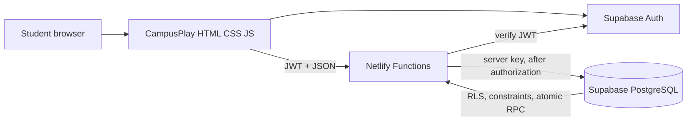
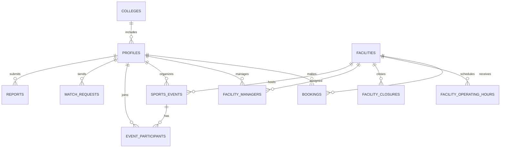

# CampusPlay · Hackathon kit

## Problem

College students often want to play but cannot easily find an available ground, coordinate a time, or gather enough teammates. Facility details and informal group chats are fragmented, which makes the simplest first step—getting a game going—harder than it should be.

## Solution

CampusPlay brings campus facilities, time-slot booking, pickup events, and teammate discovery into one student-first platform. Students can find a suitable facility, reserve a time, and invite compatible players. Campus managers get an authorized view of facilities and operations.

## Why it stands out

- A practical end-to-end flow from facility discovery to a team on the pitch.
- Conflict-safe bookings backed by a PostgreSQL exclusion constraint, even under concurrent requests.
- A transparent teammate score based on shared sport, schedule, skill, and team size.
- Campus-specific facilities and student profiles, with server-side authorization and RLS foundations.
- A live-demo-friendly seeded experience that works before cloud credentials are added.

## Feature list

Facility discovery and search; hourly availability; booking reference/history/cancellation; event creation and participation; teammate filters and explanations; student profile; manager/admin foundations; responsive layouts; Supabase Auth; Netlify Functions; PostgreSQL RLS and constraints.

## Architecture

## Data model

## Three-minute demo script

**0:00–0:25 — The pain.** “You want to play, but first you need a ground, a free slot, and enough people. Those details live in different places.”

**0:25–0:55 — Discover.** Open Playgrounds; search football; point out price, capacity, amenities, and opening hours. Open facility details.

**0:55–1:25 — Book.** Choose a date and slot, set team size, confirm, and show the booking reference in My bookings. Briefly show cancellation. Explain that the database range constraint handles competing requests.

**1:25–1:55 — Bring people together.** Create a Friday pickup event, then join another event and show the participant count. Mention the database lock/unique participant key.

**1:55–2:25 — Find teammates.** Filter by football and evenings. Show the match percentage and the readable explanation, then point out that only public player details are returned.

**2:25–2:45 — Campus operations.** Show the facility manager view, authorized facility editing API, and the distinction between sample dashboard counts and live admin reports.

**2:45–3:00 — Close.** “CampusPlay makes the path from ‘we should play’ to a real game shorter: find your game, book your ground, play together.”

## Presentation outline

1. The campus coordination problem (30 sec).
2. Student journey demo: discover → book → gather → play (90 sec).
3. Reliability/security: JWT verification, RLS, exclusion constraint, atomic event joins (35 sec).
4. Transparent player recommendations and campus manager value (25 sec).
5. Impact, next steps, ask (20 sec).

## Judge questions and answers

**How do you prevent double bookings?** A PostgreSQL exclusion constraint rejects overlapping confirmed time ranges for the same facility. This is enforced inside the database, so concurrent requests cannot both win.

**Is matchmaking AI?** No. It is an explainable rule-based score using overlapping sports, schedule, skill, and preferred group size.

**How do you protect student information?** The browser uses only the public anon key. Functions validate Supabase JWTs, omit private email from player results, and use a server-only key after authorization. RLS limits direct data access.

**Can managers edit every facility?** No. The management function checks admin status or a facility assignment and limits manager changes to the assigned facility.

**How will you grow beyond one campus?** Add verified college onboarding, campus-specific facility inventories, inter-college events, notifications, and integrations with campus recreation systems.

**What is the next feature?** Live slot refresh with realtime updates and notification reminders, followed by richer team scheduling and college verification.

## Future scope

Verified college onboarding; live availability refresh; push/email reminders; recurring bookings; waitlists; facility closure reporting; inter-college tournaments; richer accessibility and utilization analytics; moderated community safety tools.
